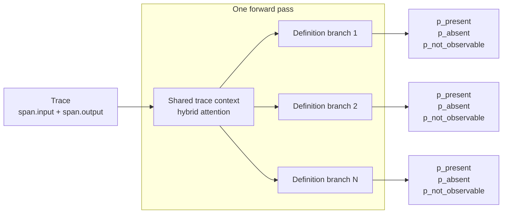

> For clean Markdown of any page, append .md to the page URL.
> For a complete documentation index, see https://respan.ai/docs/llms.txt.
> For AI client integration (Claude Code, Cursor, etc.), connect to the MCP server at https://respan.ai/docs/_mcp/server.

# span-01

> span-01 is Respan's reasoning classifier. It applies plain-language behavior definitions to agent traces and returns present, absent, and not-observable probabilities in a single forward pass.

span-01 is Respan's first-party classification model. It reads a trace and a set of behavior definitions written in plain language. For each definition, it returns the probability that the behavior is present, absent, or not observable in the trace.

You define the behaviors. Prompt injection, hallucination, secrets exposure, agent loops, tool misuse, and user frustration are all definitions you write, not categories built into the model.

> **Note**
>
> span-01 scores text. Each message's `content` is a string.

In the example, the complaint and apology match their definitions. The span ends with the assistant's reply, before the customer can say whether the problem is solved. Select **Customer acceptance** to see how span-01 reports insufficient evidence.

## How it differs from an LLM judge

Like an LLM, span-01 understands natural language. Unlike an LLM judge, it doesn't generate an answer. It returns probabilities directly.

|                     | LLM-as-a-judge                                                | span-01                                                       |
| ------------------- | ------------------------------------------------------------- | ------------------------------------------------------------- |
| Output              | Generated text you parse into a label                         | `p_present`, `p_absent`, `p_not_observable` for each behavior |
| Inference           | Token-by-token generation                                     | One forward pass                                              |
| Several behaviors   | Separate prompts, or one prompt with a combined output format | Parallel branches over the same trace, in one request         |
| Not enough evidence | Must be handled in the prompt                                 | Returned as `p_not_observable`                                |
| Price               | Frontier-model input and output tokens                        | Free (Lite), or \$0.02 / 1M input tokens with free output     |

For each behavior, the three probabilities sum to about 1. `p_not_observable` means the trace can't answer the question. For example, if the trace ends at the assistant's reply, it can't show whether the customer accepted a fix. Treat that result as "unknown", not as "absent".

## Architecture

### Reason first, classify once

The hard part of classification isn't returning a label. It's applying a definition the model has never seen to context it has never encountered. span-01 is trained for general classification reasoning with RLAIF, then specialized for behavior detection. As a result, it executes new definitions in new domains instead of matching a fixed taxonomy.

### Hyper-parallel definition branches

Every definition in a request runs as its own branch over the same trace context. All behaviors are scored in one pass, so adding a behavior doesn't add a generation step. There's no per-request limit on the number of behaviors.

### Hybrid attention

Production traces are long. Hybrid attention preserves the model's reasoning across long, complex traces.

### No generation

span-01 doesn't produce tokens, write explanations, or return free-form text. The only output is a set of probabilities per behavior, and output is free.

## Where it fits

span-01 is one step inside a larger system. For a support agent, your application can:

1. Capture the turn to judge in `span.output`, with the preceding messages in `span.input`.
2. Score several behaviors in one request, such as escalation, user frustration, and prompt injection in tool output.
3. Combine the probabilities with thresholds and rules in code: hand off to a human, block the reply, raise an alert, or log the result.
4. Send uncertain cases, such as a high `p_not_observable` or a borderline `p_present`, to human review or a frontier model.

Choose thresholds using conversations you've labeled. In the Respan platform, span-01 powers [Behaviors](/docs/documentation/features/pulse/behaviors) on your traces.

## Benchmarks

### Behavior benchmark

span-01 ranks first overall on English and multilingual behavior detection. span-01 Lite outperforms Jev and Sonnet 5.

### Production behavior benchmark

Aggregate scores can hide the behaviors that matter in production, so this benchmark reports each domain separately. span-01 outperforms Jev and Sonnet 5 overall. A full frontier model (GPT-6 Sol) remains the ceiling.

### Quality vs. cost

span-01 and span-01 Lite form the Pareto frontier. span-01 Lite is free. span-01 matches the quality of frontier models that cost up to 700× more per token.

The benchmark dataset is available on [Hugging Face](https://huggingface.co/datasets/respanai/behavior-benchmark). See the [launch post](https://www.respan.ai/blog/introducing-span-1) for the full methodology.

## Models and pricing

| Model        | `model` ID               | Input              | Output |
| ------------ | ------------------------ | ------------------ | ------ |
| span-01 Lite | `span-01-free` (default) | Free               | Free   |
| span-01      | `span-01-pro`            | \$0.02 / 1M tokens | Free   |

* **Input tokens:** the trace plus all behavior definitions, reported as `usage.input_tokens`.
* **span-01 Lite:** has a daily cap that resets at 00:00 UTC.
* **span-01:** requires Respan credits.

## Call span-01

Send a trace and its behavior definitions to [`POST /api/v1/scores`](/docs/apis/gateway/run-span-01), and select a model with the `model` field.

#### [Quickstart](/docs/documentation/span-01/quickstart)

Score your first trace with one API call.
